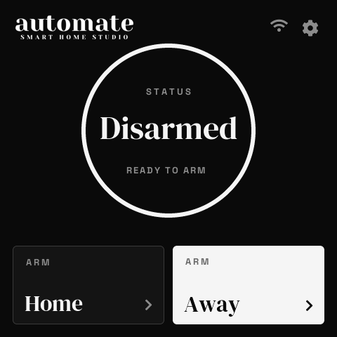
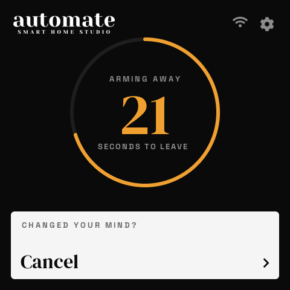
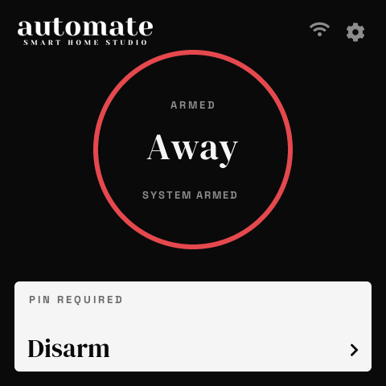
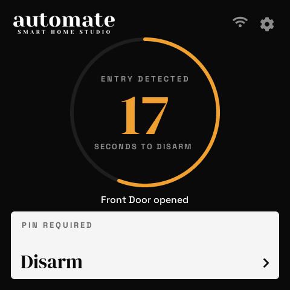
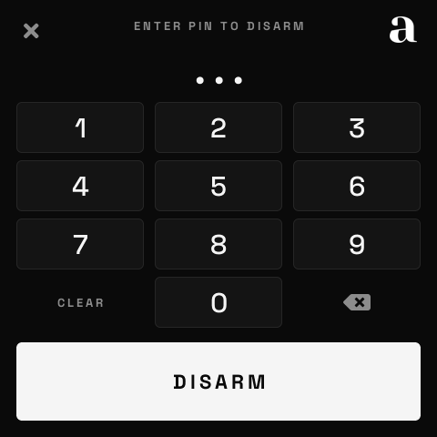
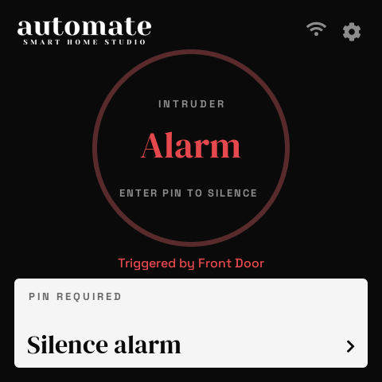

# SenseCAP Alarm Keypad

Turn a **Seeed SenseCAP Indicator D1** (4" 480×480 touch screen, ESP32-S3) into a wall-mounted keypad for **[Alarmo](https://github.com/nielsfaber/alarmo)** in Home Assistant.

- **Talks to Alarmo over MQTT** using Alarmo's built-in MQTT support. No blueprint or automation needed.
- **Branded for Automate Smart Home Studio:** monochrome, serif headlines, a status ring that fills with the exit/entry countdown.
- **One tap to arm** (Home / Away). The PIN pad only appears when a PIN is needed: to disarm, during the entry delay, or to arm if *Require PIN to arm* is on.
- **PINs only exist in Alarmo.** The keypad forwards what you type; Alarmo checks it, applies user permissions and logs who disarmed.
- **Entry delay beep:** the keypad sounds a constant tone through its own buzzer from the moment a door opens until you disarm or the siren goes off. This needs the [buzzer firmware](#buzzer) on the D1's second chip (a one-time flash).
- **Live status:** Off / Armed / exit countdown / entry countdown with the door that opened / ALARM, plus wrong-PIN and "close first" messages.

> ⚠️ This is a convenience keypad, not a certified security product. If Home Assistant or the MQTT broker is down, the keypad can't arm or disarm. Make sure your sirens and sensors fail safe on their own (e.g. Konnected's standalone alarm logic).

| Ready | Leaving | Armed | Entry delay | PIN pad | Alarm |
|---|---|---|---|---|---|
|  |  |  |  |  |  |

---

## What you need

| Item | Notes |
|---|---|
| SenseCAP Indicator **D1** | D1S / D1L / D1Pro also work. Their extra sensors are unused. |
| Home Assistant 2024.10+ | With the ESPHome integration |
| [Alarmo](https://github.com/nielsfaber/alarmo) | Installed via HACS and configured with at least one user code |
| 5 V USB-C power at the wall | e.g. a 12 V → 5 V USB-C buck converter fed from the alarm's 12 V aux supply |

## Install

### Option A: Web installer (recommended)

1. Open **https://DomMonte.github.io/sensecap-alarm-keypad/** in Chrome or Edge on a desktop computer.
2. Plug the Indicator in over USB-C and click **Install**.
3. Optionally enter Wi-Fi in the browser after flashing, or skip it and set it up on the screen.

### Option B: ESPHome dashboard

```yaml
# my-keypad.yaml
packages:
  keypad: github://DomMonte/sensecap-alarm-keypad/sensecap-alarm-keypad.yaml@main
```

You can override any `substitutions:` value, e.g. `friendly_name`.

### Buzzer

The D1's buzzer is wired to its second chip (an RP2040), not the ESP32-S3. Seeed's stock RP2040 firmware doesn't respond to beep commands, so it gets a tiny replacement, [`rp2040-buzzer.yaml`](rp2040-buzzer.yaml). It sounds a tone whenever the main firmware asks for one. This is a one-time job; the keypad firmware's OTA updates don't touch it.

1. Get `alarm-keypad-buzzer.uf2` from the release, or build it: `esphome compile rp2040-buzzer.yaml` writes `.esphome/build/alarm-keypad-buzzer/.pioenvs/alarm-keypad-buzzer/firmware.uf2`.
2. Put the RP2040 in its USB bootloader. With Seeed's stock firmware you don't need to open the case: plug the D1 in and open its RP2040 serial port at **1200 baud** (e.g. `python3 -c "import serial; serial.Serial('/dev/cu.usbmodemXXXX', 1200).close()"`). Otherwise unplug it, hold the **internal button** down with a pin ([Seeed's guide](https://wiki.seeedstudio.com/SenseCAP_Indicator_How_To_Flash_The_Default_Firmware/) shows where it is), plug the USB-C in, then let go.
3. A USB drive called **RPI-RP2** appears. Copy the `.uf2` onto it. The drive closes by itself when it's done.
4. Unplug and replug the D1. A short **chirp** at power-up means the buzzer firmware is running.

Tip: back up Seeed's firmware first while the drive is mounted: `picotool save -a rp2040-stock.uf2`.

Without it, everything else works; the keypad is just silent. The beep can be switched off with **Entry Delay Beep** in HA (keypad device › Configuration).

## Home Assistant setup

**Brand theme:** `ha-theme/` holds an Automate theme for Home Assistant itself (colours, fonts, logo in the sidebar and tab icon). Install steps are in the setup guide.

**See [docs/home-assistant-setup.md](docs/home-assistant-setup.md)** for everything on
the HA side: the Mosquitto login, Alarmo MQTT/code/delay settings, the keypad's
entities, the **Apple Home "Alarm" helper** (Settings › Devices & services ›
Helpers › Alarm), the HomeKit Bridge exclusion, the dashboard cards and the test
fixtures.

## First-time setup (on the screen)

1. **Welcome** → *Get started*
2. **Wi-Fi.** Pick your network and type the password, or use *Set up with my phone instead* (captive portal) or Home Assistant's Improv (Bluetooth) discovery.
3. **Add to Home Assistant.** Accept *New device discovered* in HA.
4. **MQTT login.** In HA open the keypad device › Configuration and fill in MQTT Broker, Port, Username and Password. The keypad moves on once Alarmo's state arrives.
5. **Done.**

## Using the keypad

| Action | How |
|---|---|
| Arm | Tap **Arm Home** or **Arm Away**. With *Require PIN to arm* on, the PIN pad opens first. |
| Disarm / cancel arming | Tap **Disarm** (or **Cancel**) and type your PIN. It sends as soon as the last digit is in (set **PIN Length** in HA to match your Alarmo PINs). |
| Entry delay / alarm | The PIN pad opens by itself |
| Settings | **Tap** the gear (next to the Wi-Fi icon): brightness, screen timeout, Require PIN to arm, **Rotate** (90° per tap), device info, restart, re-run setup |
| Wake screen | Touch anywhere, or press the side button. It also wakes during arming, entry delay and alarm. |
| Factory reset | Hold the side button for 10 seconds |

After 5 wrong PINs the keypad locks itself for 60 seconds.

## How it works

```
 Keypad ── MQTT pub  alarmo/command {"command":"ARM_AWAY|ARM_HOME|DISARM","code":"…"} ──▶ Mosquitto ──▶ Alarmo
 Keypad ◀─ MQTT sub  alarmo/state (retained) + alarmo/event (JSON) ────────────────────── Mosquitto ◀── Alarmo
 Keypad ◀─▶ ESPHome API ◀─▶ HA  (adoption, OTA, settings, MQTT login)
```

The `code` field is only sent when a PIN was typed. Codes are never logged or stored on the device.

## Building from source

```bash
pip install esphome==2026.9.1
esphome run sensecap-alarm-keypad.yaml
```

`rp2040-buzzer.yaml` is the separate firmware for the D1's RP2040 (see [Buzzer](#buzzer)).

Packages: `hardware-d1.yaml` (pins, buzzer line), `core.yaml` (network/API/OTA), `alarm.yaml` (keypad logic), `mqtt.yaml` (Alarmo MQTT transport), `theme.yaml` (brand fonts/colours/logo), `ui-main.yaml` (main screen + PIN pad) and `ui.yaml` (onboarding + settings).

### Desktop preview

The main screen can be rendered on a Mac/Linux desktop without the hardware (needs SDL2):

```bash
esphome compile preview/preview.yaml
preview/render.sh          # writes preview/out/<scenario>.png
``` CI builds every push. Publishing a GitHub release deploys the web installer and the OTA manifest to GitHub Pages.

## Contact

Built by **Automate Smart Home Studio**. Questions, installs or custom work:
[domenic@automatehomes.com.au](mailto:domenic@automatehomes.com.au)

## License

MIT
